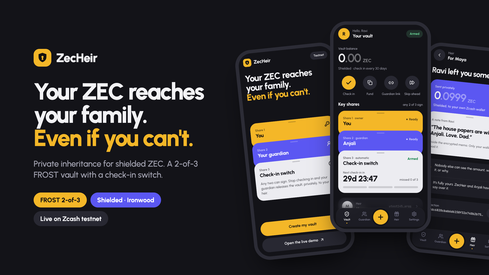
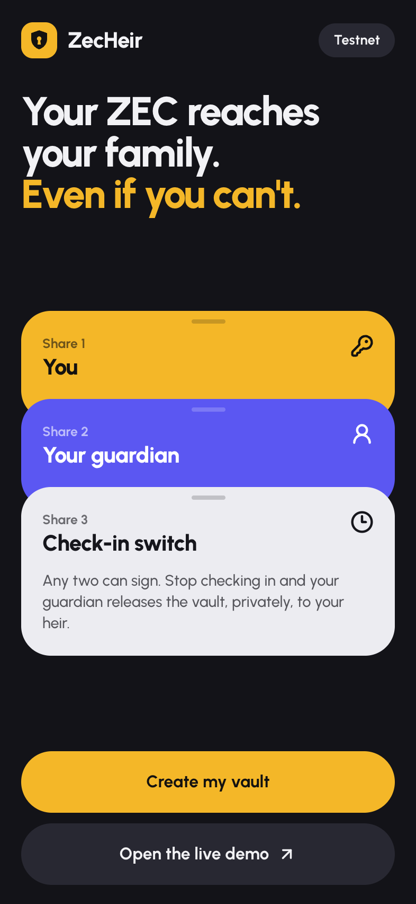
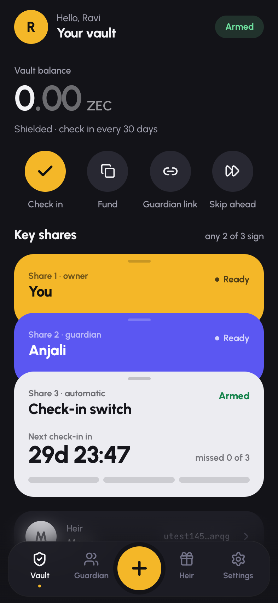
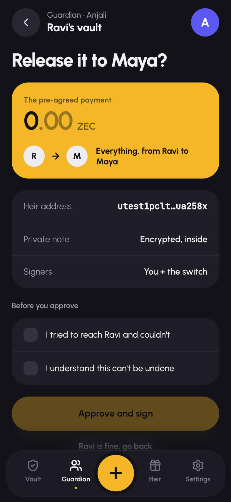
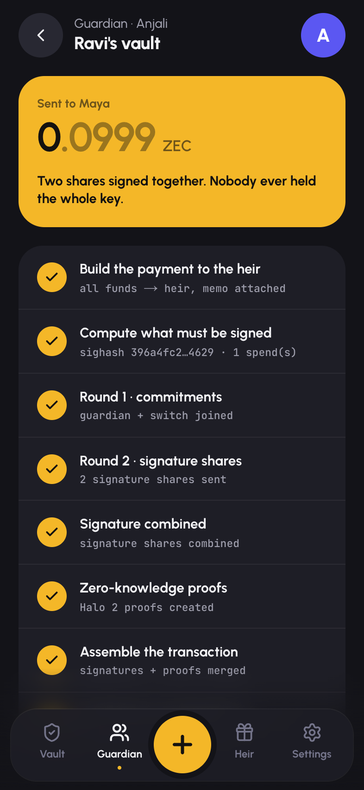
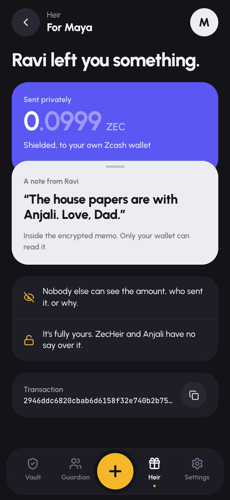

# ZecHeir

**Private inheritance for shielded ZEC, secured by FROST threshold signatures.**

Your shielded ZEC reaches your family, even if you can't. Nobody can take it early, and nobody else will ever know it exists.

> Built for the Zcash India **Build on Zcash** bounty (FROST · Wallets & UX). Runs on **Zcash testnet**.



**Live app:** https://zecheir.vercel.app (installable PWA; on iPhone use Safari → Share → Add to Home Screen)

> The signing service (frostd + the switch) runs on the builder's machine during the hackathon. When it's offline, the app shows a
> **recorded copy** of the real testnet release below, clearly labelled, with actions disabled. To run everything yourself, see [Running it](#running-it).

**Proof it works on-chain:** a vault held by a 2-of-3 FROST key released its funds to the heir in testnet transaction
[`2946ddc6…6a39`](https://testnet.zcashexplorer.app/transactions/2946ddc6820cbab6d6158f32e740b2b75e6a44cd520d44d3db71cb11c24f6a39)
(block 4,666,761, Ironwood pool). The heir's wallet received 0.0999 TAZ and decrypted the memo
*"The house papers are with Anjali. Love, Dad."* Only the guardian and switch shares signed; nobody ever held the full key.

| Welcome | Vault | Guardian approves | Signed | Heir receives |
|---|---|---|---|---|
|  |  |  |  |  |

---

## The problem

Privacy cuts both ways. If someone holding shielded ZEC dies or loses access, their family can't even *see* that the money exists. It's gone forever.

The usual fix, writing the seed phrase on paper and leaving it in a drawer, is dangerous: whoever finds that paper can take everything **today**.

Shielded Zcash has no built-in multisig, so "dead man's switch" designs from other chains (smart-contract timelocks, on-chain multisig) don't exist for shielded funds.

## What ZecHeir does

ZecHeir puts your shielded ZEC in a **2-of-3 FROST vault**. One spending key is split three ways:

| Share | Held by | Role |
|---|---|---|
| **Owner** | You | Everyday control |
| **Guardian** | A trusted person (sister, lawyer) | Approves the release, only after the grace period |
| **Check-in switch** | The ZecHeir service | A dead man's switch that only ever co-signs **one** pre-agreed payment |

Any 2 of the 3 can sign. **No single party can move the funds.**

1. **Set up:** pick an heir address, a check-in rhythm (7/30/90 days) and a private note to the heir.
2. **Check in:** a tap in the app (or the Telegram bot's "I'm here" button) resets the switch.
3. **Missed check-ins:** after 3 misses in a row a grace period starts, and the guardian is alerted.
4. **Release:** when the grace period ends, the guardian approves. Guardian + switch FROST-sign the pre-agreed transaction, **everything goes to the heir**, with the owner's note in the encrypted memo.

### Why it's safe

- The switch alone can't steal: it needs a second share.
- The guardian alone can't steal either.
- **The switch builds the release transaction itself and refuses to sign any message other than that transaction's sighash.** A compromised guardian or coordinator can't trick it into signing a different payment.
- Before the grace period ends, the server refuses to start a release (`409`).

### Why it's private

- The vault is a shielded Orchard/Ironwood address. Balance, heir address and amount are invisible on-chain.
- A FROST signature is a normal RedPallas signature, so on-chain **nobody can tell the vault is shared, or that the payment is an inheritance**.
- The switch only holds a **viewing key** for the vault: it can show the balance, never spend alone.
- The owner's last message rides inside the **encrypted Zcash memo**, readable only by the heir.

---

## How it works

```
 ┌──────────────┐   HTTPS    ┌───────────────────────────────────────────────┐
 │  ZecHeir PWA │ ─────────▶ │ Switch service (Bun + Hono)                   │
 │  (Next.js 16)│            │  • check-in state machine                     │
 └──────────────┘            │  • release pipeline (below)                   │
        ▲                    │  • Telegram bot (grammY)                      │
        │ deep links         └───────┬──────────────┬───────────────┬────────┘
 ┌──────┴───────┐                    │              │               │
 │ Telegram bot │          zcash-devtool      frost-client      lightwalletd
 └──────────────┘          (view-only wallet,  coordinator +     testnet.zec.rocks
                            PCZT create/prove/ participants
                            frost-sign/send)        │
                                                    ▼
                                         frostd (ZF FROST server)
                                         behind a cloudflared HTTPS tunnel
```

### The release pipeline (`server/src/release.ts`)

| Step | Tool | What happens |
|---|---|---|
| 1. Build | `zcash-devtool pczt create-max` | A PCZT sending **all** vault funds to the heir, memo attached |
| 2. Sighash | `zcash-devtool pczt frost-sign` | Prints the v6 sighash and each spend's randomizer (alpha) |
| 3–5. FROST | `frost-client coordinator` + 2 × `participant` via `frostd` | Two-round FROST (RedPallas, rerandomized). Each share checks the message == sighash before answering `y` |
| 6. Prove | `zcash-devtool pczt prove` | Halo 2 proofs (no spend authority needed) |
| 7. Combine | `zcash-devtool pczt combine` | Signatures + proofs |
| 8. Broadcast | `zcash-devtool pczt send` | Extract and send to testnet, returns the txid |

### Key generation

`frost-client trusted-dealer -C redpallas` splits a fresh key 2-of-3 between owner, guardian and switch. `zcash-sign generate --ak <group key>` turns the FROST group key into an Orchard full viewing key and vault address. **It is randomized**, so the service runs it exactly once per vault and stores the result.

### What we added to the Zcash tooling

Testnet has activated NU7 (the **Ironwood** pool, v6 transactions). frost-tools' `zcash-sign` is pinned to older librustzcash crates and fails with `UnknownConsensusBranchId` on today's transactions. We added a `pczt frost-sign` subcommand to [zcash-devtool](https://github.com/zcash/zcash-devtool), ported from `zcash-sign sign` and built on zcash-devtool's current librustzcash revision. It prints the sighash and randomizers and applies externally produced FROST signatures to Orchard **and Ironwood** spends. The patch is in [`patches/zcash-devtool-frost-sign.patch`](patches/zcash-devtool-frost-sign.patch).

---

## Repository layout

```
web/        Next.js 16 PWA (installable, mobile-first): landing, setup, vault, guardian, heir
server/     Switch service: API, state machine, FROST + wallet orchestration, Telegram bot
  src/schedule.ts   armed → grace → releasable (pure, unit-tested)
  src/frost.ts      frost-client coordinator/participants through frostd
  src/wallet.ts     zcash-devtool view-only wallet + PCZT steps
  src/release.ts    the 8-step release pipeline
  src/vaults.ts     vault creation (key split) and lifecycle
  src/bot.ts        Telegram reminders + guardian alerts
patches/    zcash-devtool `pczt frost-sign` patch
tools/      (gitignored) frost-tools + zcash-devtool sources and binaries
data/       (gitignored) key shares, wallets, vault state
```

## Running it

**Requirements:** Rust (stable), Bun ≥ 1.1, Node ≥ 22, `cloudflared`, and about 5 GB of free disk for the Rust builds.

### 1. Build the Zcash tools

```bash
mkdir -p tools/bin
git clone https://github.com/ZcashFoundation/frost-tools tools/frost-tools
(cd tools/frost-tools && cargo build --release --locked -p frost-client -p frostd -p zcash-sign \
  && cp target/release/{frost-client,frostd,zcash-sign} ../bin/)

git clone https://github.com/zcash/zcash-devtool tools/zcash-devtool
(cd tools/zcash-devtool && git apply ../../patches/zcash-devtool-frost-sign.patch \
  && cargo build --release --locked && cp target/release/zcash-devtool ../bin/)
```

### 2. Start frostd behind HTTPS

`frost-client` only speaks HTTPS. A Cloudflare quick tunnel gives frostd a real certificate:

```bash
tools/bin/frostd -i 127.0.0.1 -p 2744 --no-tls-very-insecure &
cloudflared tunnel --url http://127.0.0.1:2744     # prints https://<name>.trycloudflare.com
```

### 3. Start the switch service and the PWA

```bash
cd server && bun install
FROSTD_URL=<name>.trycloudflare.com:443 \
TELEGRAM_BOT_TOKEN=<optional, from @BotFather> \
APP_URL=http://localhost:3001 \
bun run index.ts                                   # http://localhost:8787

cd ../web && bun install
NEXT_PUBLIC_API_URL=http://localhost:8787 \
NEXT_PUBLIC_TELEGRAM_BOT=<optional bot username> \
bun run dev -- -p 3001                             # http://localhost:3001
```

### 4. Try it

1. Open `http://localhost:3001` and tap **Create my vault**. Enter an heir testnet address (`utest1…`) and pick **30 sec** check-ins (demo mode).
2. Fund the vault address shown on the vault screen with testnet TAZ, e.g. `npx zcash-faucet <address>` ([zcash-faucet](https://github.com/anukulpandey/zcash-faucet)). Wait about 10 blocks until it's spendable.
3. Check in, or open **Demo controls** and skip ahead: *Miss 3 check-ins* → *Skip grace period*.
4. Open the **Guardian** view, tick both boxes, and press **Approve and sign**. Watch the FROST rounds, proofs and broadcast live.
5. Open the **Heir** view to see the received amount, the decrypted note and the txid.

### Tests

```bash
cd server && bun test        # check-in / grace / release state machine
bun scripts/frost-smoke.ts   # a real 2-of-3 FROST session through frostd (dummy message)
```

## API

| Method | Path | |
|---|---|---|
| `POST` | `/api/vaults` | Create a vault (splits the key, derives the vault address) |
| `GET` | `/api/vaults/:id` | Status, countdown, balance, release progress |
| `POST` | `/api/vaults/:id/checkin` | Owner check-in (resets the switch) |
| `POST` | `/api/vaults/:id/approve` | Guardian approval → starts the FROST release (409 before grace ends) |
| `POST` | `/api/vaults/:id/demo/fast-forward` | Demo only: simulate missed check-ins |

## Honest limitations (MVP)

- **Testnet only. Not audited.** The FROST demo tools are marked "for demo purposes only" by the Zcash Foundation.
- **Trusted-dealer key generation.** For the MVP the service generates all three shares. The next step is `frost-client dkg`, so each holder generates their own share on their own device and no dealer ever sees the full key.
- **Guardian signing is simulated on the server.** In the MVP the guardian's share lives next to the switch's, and the guardian's "Approve" button triggers their participant process. In production the guardian runs `frost-client participant` (or an in-browser FROST participant) on their own device.
- **The timer is trusted.** The switch service decides when the grace period is over. Trust is limited because it can only co-sign the single pre-agreed payment, and only with the guardian.
- The quick-tunnel URL changes on restart. Use a named tunnel or nginx + TLS for anything persistent.

## Roadmap

- DKG-based vault creation, and guardian signing in the browser (FROST WASM)
- Several heirs with percentage splits (multiple outputs in the release PCZT)
- Owner-initiated spends from the vault (owner + switch)
- Web Push check-in reminders (the PWA already ships a manifest)

## License

MIT. See [LICENSE](LICENSE).

Built on [frost-tools](https://github.com/ZcashFoundation/frost-tools) (MIT/Apache-2.0) and [zcash-devtool](https://github.com/zcash/zcash-devtool) (MIT/Apache-2.0).
